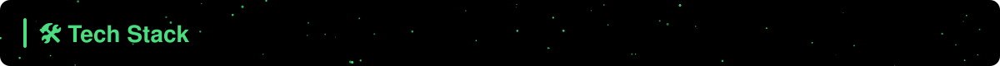

<h1 align="center"><b>Hi , I'm Juan Fernandez </b></h1>

  
  
  
  

---

<picture>
  <source media="(prefers-color-scheme: light)" srcset="assets/section-about-light.svg" />
  
</picture>

I'm a **full stack developer** from **Buenos Aires, Argentina** 🇦🇷. My favorite languages are **C#** and **JavaScript**, and I build software designed to be secure from day one.

- 💼 **C# / .NET Core Developer** at **MAE Software** — ERPs and management systems (including clinics) with .NET, Entity Framework and SQL Server.
- 🔐 Expanding into **cybersecurity** — Blue Team, SOC and secure development. I train on hands-on labs and bring what I learn back into the systems I build.
- 🕹️ I also enjoy hardware — especially **retro hardware**.

 

---

<picture>
  <source media="(prefers-color-scheme: light)" srcset="assets/section-stack-light.svg" />
  
</picture>

<picture>
  <source media="(prefers-color-scheme: light)" srcset="assets/stack-constellation-light.svg" />
  
</picture>

#### 🖥️ Frontend

  
   
  

#### ⚙️ Backend

  

#### 🗄️ Databases

  
   
  

#### 🧰 DevOps & Tools

  
   
  

---

<picture>
  <source media="(prefers-color-scheme: light)" srcset="assets/section-education-light.svg" />
  
</picture>

<picture>
  <source media="(prefers-color-scheme: light)" srcset="assets/timeline-light.svg" />
  
</picture>

<b>Full details</b>

 

| | Course | Institution | When |
|---|--------|-------------|------|
| 🎓 | **University Technician in Programming** | UTN — Facultad Regional Avellaneda | Jun 2023 – May 2026 · ✅ Graduated |
| 🛡️ | **Cybersecurity Foundations Bootcamp (BTC262)** — 40 h | BASE4 Security | Aug – Sep 2026 · ✅ Certified |
| 🌐 | **Cybersecurity Essentials Core+** — 70 h, scholarship (CCST Cybersecurity · CyberOps · Defense Analyst) | Edutek Latam · Cisco NetAcad | Sep – Nov 2026 · ⏳ In progress |
| 🖧 | **Mis Primeros Pasos en Tecnología** — 60 h, scholarship (networking, Windows Server & AD, Linux, cabling) | Edutek Latam · Cisco NetAcad | Sep – Nov 2026 · ⏳ In progress |
| 🛡️ | **Blue Team labs** — defensive investigations and incident analysis | [CyberDefenders](https://cyberdefenders.org/blue-team-labs/) · [Blue Team Labs Online](https://blueteamlabs.online/) | 🔄 Ongoing |
| 🧪 | **Offensive labs** — recon, exploitation, privilege escalation | TryHackMe · Hack The Box · PortSwigger | 🔄 Ongoing |

---

<picture>
  <source media="(prefers-color-scheme: light)" srcset="assets/section-projects-light.svg" />
  
</picture>

| Project | Description | Stack |
|---------|-------------|-------|
| [Translate](https://github.com/Juanma7882/Translate-juanma7882) | Local, private desktop translator: OCR on any screen region or live system-audio transcription, translated offline with on-device ML models. Nothing is written to disk; models are SHA-256 verified | Rust, ONNX Runtime, Electron |
| [Gestión de Turnos](https://github.com/Juanma7882/mini-sistema-de-gesti-n-de-turnos) · [🌐 live](https://gestion-turnos-rho.vercel.app) | Clinic appointment system with Admin/Professional roles, JWT + rotating refresh tokens, rate limiting and real-time updates. Tested with xUnit and CI on GitHub Actions | .NET 9, React, SignalR |
| [La Parrilla de Don Juan](https://github.com/Juanma7882/la-parrilla-de-don-juan-2026) | Restaurant management mobile app I led: QR table check-in, real-time orders and per-table customer–waiter chat, push notifications (FCM) sent by Edge Functions triggered from a database webhook, PDF invoices by email, and staff roles (waiter, kitchen, bar, host) | Angular, Ionic, Capacitor, Supabase |
| [Red Social](https://github.com/Juanma7882/Red-Social-Juan-Fernandez) · [🌐 live](https://juan-fernandez-tp-2-prog-4-2026-c1.vercel.app) | Social network PWA with posts, likes and comments, short-lived JWT with session renewal, role-based admin panel and a stats dashboard. Dockerized, tested with Jest and Vitest | NestJS, MongoDB, Angular |
| [Arcade](https://github.com/Juanma7882/Arcade-Juan-Fernandez) · [🌐 live](https://fernandez-juan-tp-1-prog-4-2026-c1.vercel.app) | Minigames platform with 4 games, global ranking and real-time chat | Angular, Supabase |
| [SistemaVenta](https://github.com/Juanma7882/VentaDotNet) | Sales-management REST API with layered architecture, users/roles and reports | ASP.NET Core, SQL Server |
| [PowerType](https://github.com/AnderssonPeter/PowerType) | Open-source contribution: extended PowerShell autocomplete dictionaries (git, docker, npm, adb) | PowerShell |
| [Clima](https://github.com/Juanma7882/clima) · [🌐 live](https://clima-cyan.vercel.app) | Weather app with hourly and 6-day forecast | JavaScript, Vite |

---

<picture>
  <source media="(prefers-color-scheme: light)" srcset="assets/section-stats-light.svg" />
  
</picture>

